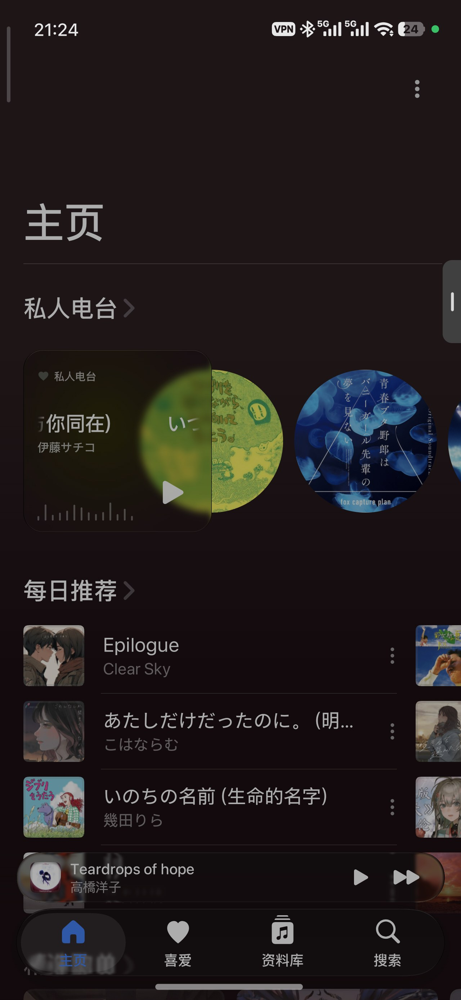
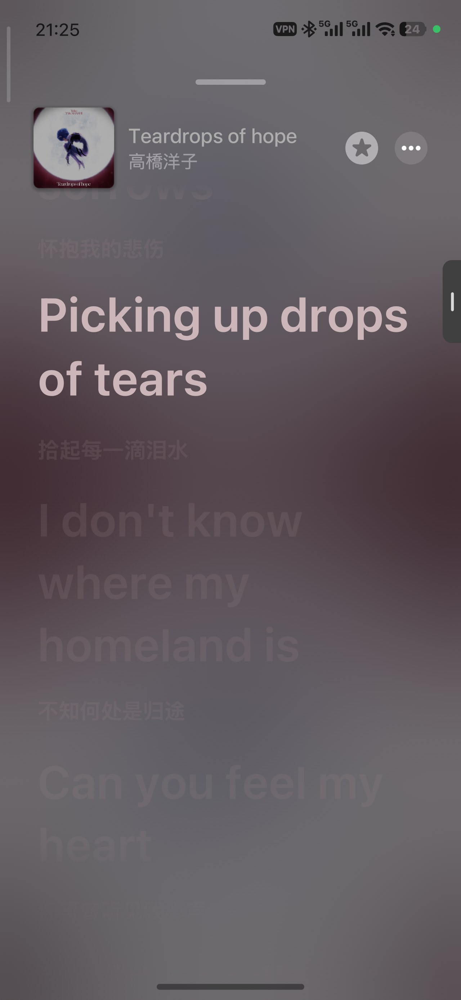
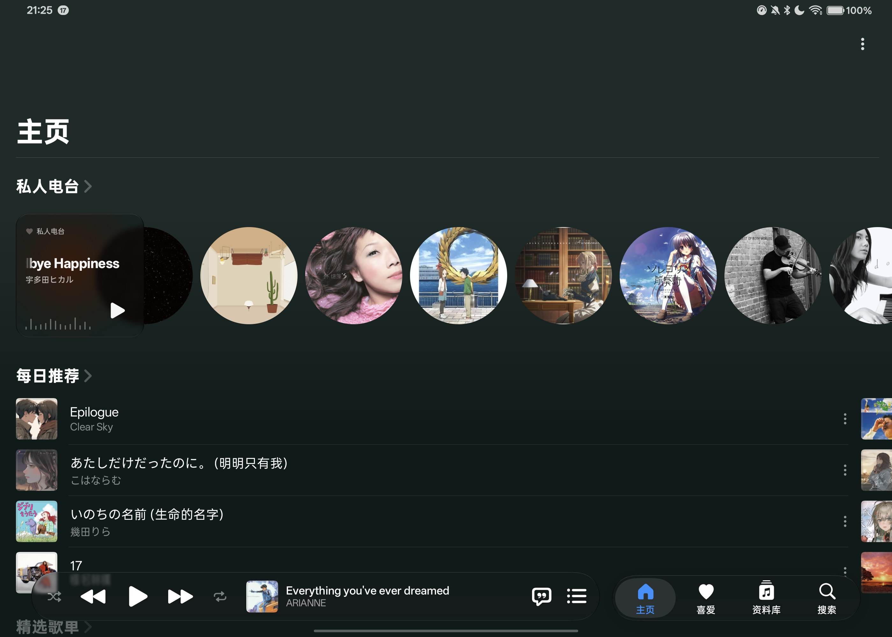
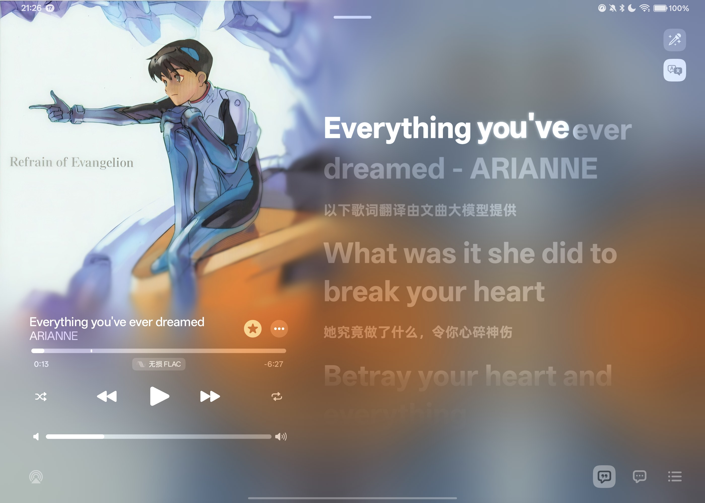

# Sonify

<p align="center">
  
</p>

**Sonify** 是一款 Android 音乐播放器：液态玻璃质感的 Compose 界面 + Media3 播放内核，
支持酷狗在线曲库与本地资料库，深度适配手机与平板两种形态。


## 特性

- **液态玻璃 UI 与主题定制** — 基于 Backdrop 与 Haze 的实时背景采样与模糊，统一应用 iOS 27 双层立体玻璃描边；支持自定义主题色（11 种预设与网格 / 色谱 / 滑块取色器）、全局玻璃模糊强度调节及底栏自定义排序与显隐。
- **播放页与视觉动效** — 支持 Pear Wall 流体网格、专辑动态封面、静态 / 漂移背景与封面取色渐变，支持播放页自动隐藏状态栏，带来沉浸式全屏观感。
- **在线曲库与探索** — 酷狗音源搜索（最佳结果 + 歌曲 / 艺人 / 专辑分区）、精选歌单、每日推荐、音乐画廊（四槽位环形轮转）、听歌识曲与歌曲评论区；支持手机号验证码与二维码扫码登录，以及在线艺人详情与个人歌单管理。
- **专业音频与智能播放** — 标准到超高音质自由切换（带探测与失败自动回退）、智能过渡（Crossfade 节拍与能量分析融合）、ExoPlayer 解码策略切换（Auto / FFmpeg / System）、实时人声分离（TFLite 推理，比例可调）、外部音频直接打开、倍速播放与睡眠定时器。
- **歌词体验** — 整页卡拉 OK 逐字高亮、翻译、HDR 高光调节、自定义字体与高潮起点标记，支持状态栏歌词（Hook 方案）及车载蓝牙歌词。
- **多端适配与桌面小组件** — 深度适配手机与平板横屏分栏布局；提供 4×2、4×1、2×2 三种桌面小组件；资料库支持 MochiIndexBar 多语言字母索引与全场景排序。
- **后台播放与云端更新** — 基于 Media3 / MediaSession 的稳定后台播放与线控支持；在「设置 → 关于」检查更新（Gitee 主源加速 + GitHub 兜底，支持正式版与预览版通道），下载后核对大小、SHA-256、包名、版本与签名身份。

## 截图

| 主页 | 播放页 | 歌词 |
|---|---|---|
|  |  |  |

<table>
  <tr>
    <td width="50%"></td>
    <td width="50%"></td>
  </tr>
  <tr>
    <td align="center"><sub>平板横屏主页</sub></td>
    <td align="center"><sub>平板横屏播放分栏</sub></td>
  </tr>
</table>

## 下载

前往 [**GitHub Releases**](https://github.com/XiaoZhi0729/Sonify/releases) 或国内镜像 [**Gitee Releases**](https://gitee.com/XiaoZhi114514/Sonify/releases) 下载最新 APK 安装包。

> 当前发布版本：**[Sonify v0.2.6](https://github.com/XiaoZhi0729/Sonify/releases/tag/v0.2.6)（测试版）**。新增自定义主题色、自定义底栏、iOS 27 双层玻璃描边、智能过渡（Crossfade）、ExoPlayer 解码策略切换、外部音频打开、画廊独立设置与横屏重构，并大幅优化 120Hz 滚动与播放页性能。完整更新记录见 [v0.2.6 更新日志](docs/CHANGELOG_v0.2.6.md)（历史版本见 [v0.2.5](docs/CHANGELOG_v0.2.5.md)、[v0.2.4](docs/CHANGELOG_v0.2.4.md)）。项目仍处于测试阶段，遇到问题欢迎提 [Issue](https://github.com/XiaoZhi0729/Sonify/issues) 反馈。

> 从 v0.1.0 升级需手动下载并覆盖安装一次；v0.1.1 起可在「设置 → 关于 → 检查更新」获取后续版本（支持开启「接收预览版更新」）。更新仅在用户确认后下载和安装，不会静默安装。

> 需要 Android 6.0（API 23）及以上。小米/Redmi（HyperOS）设备建议在「省电策略」中设为无限制并允许自启动，否则息屏后播放可能被冻结。

## 致谢

本项目是以下两个开源项目的「缝合」产物，在此向两位上游作者致谢：

| 项目 | 说明 |
|---|---|
| [MD3 Music](https://github.com/zzyoxml/md3Music) | 基于 Material Design 3 的本地音乐播放器，本项目在线播放能力的上游 |
| [Flamingo (FlamingoSank)](https://github.com/Yos-X/FlamingoSank) | 本项目的上游基底 |

部分界面与效果是从下列项目**逐行移植**或改写的，在此向原作者致谢：

| 项目 | 说明 | 许可 |
|---|---|---|
| [Cresto / Glasense](https://github.com/nevodev) | 居中玻璃弹窗、材质与动效的设计及实现来源 | Apache-2.0 |
| [Pear Wall](https://github.com/Nevodev/Pear-Wall) | 流体网格播放背景（网格形变、多重模糊、镜头预设）。修改说明见 `app/src/main/assets/licenses/pear-wall-NOTICE.txt` | Apache-2.0 |
| [Lyricify Backgrounds](https://github.com/WXRIW/Lyricify-Backgrounds) | Pear Wall 的网格控制点预设与观感上游 | Apache-2.0 |
| [NexioSchedule](https://github.com/HaoZai000/NexioSchedule) | 顶栏玻璃圆钮、液态玻璃下拉弹层、渐进模糊顶栏 | AGPL-3.0 |
| [AndroidLiquidGlass](https://github.com/Kyant0/AndroidLiquidGlass) | 液态玻璃滑块、自适应亮度采样 | Apache-2.0 |
| [ComposeOverscroll](https://github.com/Cormor/ComposeOverscroll) | 列表越界回弹（`overscroll_core` 模块） | GPL-3.0 |
| [Tailwind CSS](https://github.com/tailwindlabs/tailwindcss) | 玻璃对话框的配色取值。见 `app/src/main/assets/licenses/cresto-THIRD_PARTY_NOTICES.md` | MIT |

同时感谢以下开源库：

[Jetpack Compose](https://developer.android.com/jetpack/compose) ·
[Media3 / ExoPlayer](https://github.com/androidx/media3) ·
[Media3 FFmpeg 扩展](https://github.com/androidx/media/tree/release/libraries/decoder_ffmpeg)（音频软解） ·
[Coil](https://github.com/coil-kt/coil) ·
[Accompanist](https://github.com/google/accompanist) ·
[Accompanist Lyrics](https://github.com/6xingyv/accompanist-lyrics-ui)（歌词渲染，本项目打补丁修改并内置于 `libs/maven`） ·
[Backdrop](https://github.com/Kyant0/backdrop)（液态玻璃背景模糊，源码定制内置于 `app/src/main/java/com/kyant/`） ·
[Haze](https://github.com/chrisbanes/haze)（模糊玻璃材质） ·
[Shapes](https://github.com/Kyant0/Shapes)（连续曲率圆角） ·
[Cupertino](https://github.com/alexzhirkevich/cupertino) ·
[ComposeDataSaver](https://github.com/FunnySaltyFish/ComposeDataSaver) ·
[ConfettiKit](https://github.com/vinceglb/ConfettiKit) ·
[AndroidUtilCode](https://github.com/Blankj/AndroidUtilCode) ·
[AndroidX Palette](https://developer.android.com/jetpack/androidx/releases/palette) ·
[Material Color Utilities](https://github.com/evant/material-color-utilities) ·
[MMKV](https://github.com/Tencent/MMKV) ·
[OkHttp](https://github.com/square/okhttp) ·
[Gson](https://github.com/google/gson) ·
[TinyPinyin](https://github.com/promeG/TinyPinyin) ·
[TensorFlow Lite](https://github.com/tensorflow/tensorflow)（人声分离推理） ·
[TagLib](https://github.com/Kyant0/taglib) ·
[libPhonograph](https://github.com/FoedusProgramme/libPhonograph)（本地音乐库扫描） ·
[Lyric Getter API](https://github.com/xiaowine/Lyric-Getter-Api) ·
[mochi-compose](https://github.com/feice11/mochi-compose)（HDR 高光）

## 构建与测试

仓库自带 Gradle wrapper（Gradle 9.3.1），需要 **JDK 17+** 与
Android Studio（SDK 37）。Windows PowerShell 下把 `./gradlew` 换成 `.\gradlew.bat`，
多命令用 `;` 分隔而非 `&&`。

```powershell
# 运行全部 JVM 单元测试（app 与 overscroll_core 两个模块）
./gradlew test

# 只跑 app 模块的 debug 单元测试
./gradlew :app:testDebugUnitTest

# 组装调试包（产物在 app/build/outputs/apk/debug/）
./gradlew assembleDebug
```

单元测试位于 `app/src/test/java/yos/music/player/`，以数据层与纯逻辑为主
（音质解析链、歌词加载、导航、UI 几何等），可完全在 JVM 上运行，无需连接设备。

说明：`release` 构建类型已启用混淆与资源收缩（`minifyEnabled`/`shrinkResources`），
但仓库不包含签名配置；签名与发布流程属于本地发布环节。

## 架构速览

单 Activity 架构，UI 全部使用 Jetpack Compose，播放内核基于 AndroidX Media3。

- 应用模块 `:app`，`applicationId` 为 `com.sonify.music`；另有回弹滚动库 `:overscroll_core`
- Gradle 根工程名 `Flamingo` 为历史遗留内部标识，与对外名称 Sonify 不冲突

| 职责 | 入口 | 位置（`app/src/main/java/yos/music/player/` 下） |
|---|---|---|
| 媒体控制（播放/队列/音质切换的单一事实源） | `object MediaController` | `code/MediaController.kt` |
| 在线曲库仓库 | `object KugouRepository` | `data/repositories/KugouRepository.kt` |
| 音质切换策略（纯函数，表格驱动 JVM 单测覆盖） | `object QualitySwitchPolicy` | `data/repositories/QualitySwitchPolicy.kt` |
| 主要 UI 页面 | `Home`、`NowPlaying`、`NowPlayingLandscape` 及 `discovery` / `gallery` / `library` / `recognition` / `search` / `comments` / `settings` 子目录 | `ui/pages/` |

欢迎 Issue 与 PR。提交前请先运行 `./gradlew test` 确认单测通过。

## License 与免责声明

本项目基于 [GPL-3.0](LICENSE) 协议开源。

本项目与酷狗官方无任何关联；在线音源能力基于公开接口实现，仅供学习与技术交流使用，
请支持正版音乐。使用本项目产生的任何问题由使用者自行承担。
